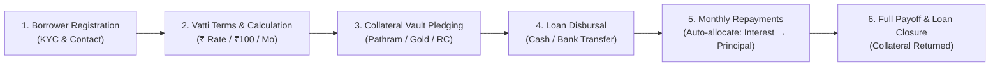

# SMS Finance Service — End-to-End Customer & System Documentation


---

## 🏛️ 1. Executive Summary & Brand Identity

**SMS Finance Service** is a community-first digital lending and vault management platform designed specifically for Indian community finance, small-business working capital, agricultural bridge finance, and asset-backed credit.

| Attribute | Specification |
|---|---|
| **Platform Name** | **SMS Finance Service** |
| **Operating Currency** | **₹ (INR - Indian Rupee)** |
| **Default Vatti Rate** | **₹2.00 per ₹100 / month** (equivalent to 24.0% p.a.) |
| **Grace Period** | **3 to 5 Community Days** |
| **Backend Core** | Spring Boot 3.3.4 (Java 17) with `BigDecimal` financial precision |
| **Frontend Portal** | React 19 + Vite + Tailwind CSS + Lucide Icons (Dark Fintech Theme) |
| **API Endpoint** | `http://localhost:8080/api` |

---

## 🔄 2. End-to-End Lending Lifecycle



---

### Step 1: Borrower Registration & KYC Onboarding
- **What happens:** Every borrower is registered with their Full Name, 10-digit Mobile Phone Number, Residential Address, and Aadhaar/PAN Card details.
- **Customer Benefit:** Quick 60-second onboarding. Once registered, borrowers receive a unique Customer Code (e.g., `CUST-1001`) with full history of past and active loans.
- **Verification:** Verified records ensure zero identity duplication and fast repeated loan disbursals.

---

### Step 2: Transparent Vatti Interest Engine (`BigDecimal`)

In traditional Indian community lending, interest is calculated transparently as **"₹X per ₹100 per month"**:

$$\text{Monthly Interest} = \frac{\text{Principal} \times \text{Vatti Rate}}{100}$$

#### Real-World Example:
If a borrower takes a loan of **₹1,00,000** at **₹2.00 Vatti**:
- **Monthly Interest:** $(1,00,000 \times 2.00) / 100 = \mathbf{₹2,000\text{ / month}}$
- **Daily Accrual (30-day standard):** $2,000 / 30 = \mathbf{₹66.67\text{ / day}}$
- **Annual Percentage Rate (APR Equivalent):** $2.00 \times 12 = \mathbf{24.0\%\text{ p.a.}}$

> **No Hidden Fees or Compounding Surprises:** The Vatti rate is fixed and previewed live on the screen before the borrower agrees to the disbursement.

---

### Step 3: Collateral & Pathram Vault Security

For asset-backed loans, physical security documents or precious items are stored safely in the SMS Finance physical vault:

1. **Original Property Deeds (*Pathram*):** Registered land documents, patta certificates, and house survey deeds.
2. **Gold Jewellery & Valuations:** Sealed and catalogued with gross weight, net purity (22K), and appraiser certificate.
3. **Vehicle RC Books & Second Keys:** Two-wheeler or commercial vehicle registration certificates.
4. **Promissory Notes & Cheques:** Signed community notes.

#### Physical Vault Locator:
Every pledged asset is assigned a specific physical location:
- *Vault Alpha — Safe Locker 3*
- *Main Vault — Deed Locker D-01*
- *Vault Beta — Shelf A*

#### Digital Scans & In-App High-Resolution Document Viewer:
- **Instant Inspection Without Opening the Vault:** When a loan contract is reviewed or audited, managers can click the **"View"** (👁️) button to open the digital scan (JPG, PNG, or PDF) directly on screen.
- **Zoom & Rotate Controls:** Inspect deed survey numbers, boundary sketches, sub-registrar seals, and jeweler appraisal purity stamps at up to 250% magnification.
- **Digital Custody Watermark Certificate:** For physical items without an immediate camera upload, the system automatically renders an official tamper-evident **Vault Custody Certificate** detailing the exact locker coordinates, borrower identity, and date.
- **Printed Custody Receipt:** Allows instant printing of document custody receipts for customer assurance.

> **Asset Return Guarantee:** The moment a loan reaches ₹0 remaining balance, the manager authorizes the return and records the release timestamp.

---

### Step 4: Loan Disbursal & Agreement

1. The manager selects the borrower and confirms the principal, rate, start date, and tenure.
2. The interactive wizard calculates the full repayment forecast.
3. Upon clicking **Authorize & Disburse Loan**, a unique Loan Account Number (e.g. `#LN-202610-001`) is generated, and capital is disbursed to the customer.

---

### Step 5: Repayments Ledger & Auto-Allocation

Borrowers can make repayments in multiple convenient ways:
- **UPI** (Google Pay, PhonePe, Paytm, BHIM)
- **Cash in Hand** at the branch counter
- **Bank Transfer** (NEFT / RTGS / IMPS)
- **Bank Cheque**

#### The Auto-Allocation Golden Rule:
When a repayment is received:
1. **Accrued Interest Priority:** The system first settles any unpaid Vatti interest up to the payment date.
2. **Principal Amortization:** Any remaining money from the payment immediately reduces the outstanding principal balance.
3. **Reduced Next Month Interest:** Because the principal is now lower, subsequent monthly interest is automatically reduced!
4. **Official Printed Receipt:** A branded receipt with receipt number, breakdown, and new balance is issued on the spot.

---

### Step 6: Payoff & Clean Loan Closure

A loan contract can be settled at any time without penalty:
- **1-Click "Payoff & Close":** Computes the exact rupee payoff amount (`Remaining Principal + Accrued Interest to Date`).
- Once recorded, the remaining principal reaches **₹0.00**.
- The loan status automatically flips to **`CLOSED`**.
- Any pledged collateral document (*Pathram* / Gold) is unlocked and returned to the customer.

---

## 📊 3. Feature Breakdown Matrix

| Feature | What It Does | Who Uses It |
|---|---|---|
| **Executive Dashboard** | Live stats: Active Principal, Disbursed, Vatti Yield, Collateral Value | Manager / Owner |
| **Loan Creation Wizard** | 4-step wizard with real-time interest previews & sliders | Cashier & Customer |
| **Instant Vatti Calculator** | What-if simulation tool for monthly interest and APR | Customer Consultation |
| **Pathram & Vault Tracker** | Physical locker management and deed return tracking | Vault Custodian |
| **Repayments Ledger** | Transaction history with printable receipts | Cashier & Accountant |
| **Borrower Directory** | KYC profiles, contact numbers, and loan counts | Administration |

---

## ❓ 4. Frequently Asked Questions (Customer Explainer)

### Q1: How is my interest calculated if I pay in the middle of the month?
**Answer:** SMS Finance uses a transparent 30-day daily accrual standard. If you borrow ₹1,00,000 at ₹2.00 Vatti (₹2,000/mo) and repay after 15 days, you only pay $₹66.67 \times 15 = ₹1,000$ in interest, plus whatever principal you choose to repay!

### Q2: Is my original property deed (*Pathram*) or gold safe?
**Answer:** Yes. Every document is catalogued in a tamper-evident physical vault locker with designated shelf coordinates (e.g. `Main Vault - Deed Locker D-01`) and is released immediately when your loan is paid off.

### Q3: Why does the system say "Cannot close loan" when I try to close it?
**Answer:** A loan account represents an active legal contract. You cannot close a loan that still has an active balance. Use the **"Payoff & Close"** button in the Loan Inspector to settle the remaining balance down to ₹0, which automatically closes the loan and issues your final receipt.

### Q4: Can I pay through PhonePe or Google Pay?
**Answer:** Yes. The cashier can select **UPI** as the payment method, record your UPI transaction reference, and print your official receipt.

---

## 💻 5. Technical Quick Start

### To Run Backend:
```bash
cd backend
.\mvnw.cmd spring-boot:run
```
*Port:* `http://localhost:8080` (H2 Console: `/h2-console`)

### To Run Frontend:
```bash
cd frontend
npm run dev
```
*Port:* `http://localhost:5173`
